# Órdenes de venta — Arquitectura de tres contenedores

Práctica del segundo parcial de Arquitectura de Computadoras. Sistema distribuido de órdenes de venta construido con **SQL Server 2022** (datos), **Flask** (API REST) y **Django** (frontend), orquestado con **Docker Compose**.

Flujo de una petición:

```
Navegador → web (Django) → api (Flask) → db (SQL Server)
```

Django nunca se conecta a SQL Server y la API es el único servicio que accede a la base de datos.

## Integrantes

| Nombre completo | Número de cuenta |
| --- | --- |
| José Benkay Zelaya Ham | 202410010191 |
| Jesús Andrés Herrera Velásquez | 202010010221 |
| Dilber Alexander Betanco Ordóñez | 202410110206 |
| Alex Eduardo Moreno Ortez | 202330110123 |
| Noé Rafael Banegas Núñez | 202410110014 |
| Erika Patricia Lagos | 201910110345 |
| Ruth Lizeth Palacios Ordóñez | 202410110195 |
| Yolanda Isamary Godoy Sierra | 202410110402 |

## Arquitectura

```
                         red bridge: ordenes-net
┌──────────────┐      ┌──────────────────┐      ┌──────────────────┐      ┌──────────────────┐
│  Navegador   │─────▶│  web (Django)    │─────▶│  api (Flask)     │─────▶│  db (SQL Server) │
│  :8000       │ HTTP │  gunicorn :8000  │ HTTP │  gunicorn :5000  │ TCP  │  :1433           │
└──────────────┘      └──────────────────┘      └──────────────────┘      └────────┬─────────┘
                                                                                   │
                                                                          volumen mssql_data
                                                                          (/var/opt/mssql)
```

| Servicio | Imagen | Puerto en el host | Límites |
| --- | --- | --- | --- |
| `db` | `mcr.microsoft.com/mssql/server:2022-latest` | solo interno `1433` | 2.00 CPU / 2 GB |
| `db-init` | misma imagen de SQL Server; ejecuta `db/init.sql` y termina | — | 0.25 CPU / 128 MB |
| `api` | `ruth2005/ordenes-api:v1.0` | `5002` → `5000` | 0.50 CPU / 256 MB |
| `web` | `ruth2005/ordenes-web:v1.0` | `8000` → `8000` | 0.50 CPU / 256 MB |

Los tres contenedores de la aplicación son `db`, `api` y `web`. `db-init` es un servicio auxiliar de un solo uso que carga el script de inicialización y se detiene.

## Tecnologías

- SQL Server 2022 (imagen oficial de Microsoft)
- Python 3.12, Flask 3.0 y `pymssql` para la API
- Python 3.12 y Django 5.0 para el frontend, con `requests` como cliente HTTP
- Gunicorn como servidor WSGI en `api` y `web`
- Docker, Docker Compose, red bridge y volumen con nombre

## Estructura del repositorio

```
Examen-Arquitectura/
├── compose.yaml
├── .env.example
├── README.md
├── db/
│   └── init.sql
├── api/
│   ├── Dockerfile
│   ├── requirements.txt
│   ├── app.py
│   └── .dockerignore
├── web/
│   ├── Dockerfile
│   ├── requirements.txt
│   ├── manage.py
│   ├── config/
│   │   ├── settings.py
│   │   ├── urls.py
│   │   └── wsgi.py
│   ├── ordenes/
│   │   ├── api_client.py
│   │   ├── views.py
│   │   ├── urls.py
│   │   └── templates/ordenes/
│   └── .dockerignore
└── evidencias/
    ├── compose-ps.png
    ├── lista-ordenes.png
    ├── nueva-orden.png
    ├── orden-creada.png
    ├── nuevo-detalle.png
    ├── detalle-agregado.png
    ├── lista-actualizada.png
    ├── editar-orden.png
    ├── orden-actualizada.png
    ├── eliminar-orden.png
    ├── pruebas-api.png
    ├── pruebas-curl.png
    ├── persistencia.png
    └── docker-stats.png
```

## Requisitos previos

- Docker Desktop con Docker Compose v2 (`docker compose version`)
- Al menos 4 GB de memoria disponibles para los contenedores
- Puertos `8000` y `5002` libres en el equipo
- Conexión a internet la primera vez, para descargar la imagen de SQL Server y las dependencias

## Configuración del archivo `.env`

El repositorio incluye `.env.example`, que no contiene contraseñas reales. Antes de levantar el proyecto:

```bash
cp .env.example .env
```

Editar `.env` con una contraseña propia para SQL Server:

| Variable | Descripción | Ejemplo |
| --- | --- | --- |
| `MSSQL_SA_PASSWORD` | Contraseña del usuario `sa`; debe cumplir la política de SQL Server | `CambiaEstaClave2026*` |
| `DB_NAME` | Nombre de la base de datos | `OrdenesDB` |
| `DOCKERHUB_USER` | Usuario de Docker Hub usado en las etiquetas de las imágenes | `ruth2005` |
| `IMAGE_TAG` | Etiqueta de versión de las imágenes | `v1.0` |
| `DJANGO_SECRET_KEY` | Clave secreta de Django | `cambia-esta-clave` |

El archivo `.env` está incluido en `.gitignore`, por lo que la contraseña real no se publica en el repositorio.

## Ejecución desde cero

```bash
git clone https://github.com/palaciosruth52-alt/Examen-Arquitectura.git
cd Examen-Arquitectura
cp .env.example .env
# editar .env y definir MSSQL_SA_PASSWORD
docker compose up -d --build
docker compose ps
```

En PowerShell, el equivalente de `cp` es `Copy-Item .env.example .env`.

La primera ejecución tarda algunos minutos porque descarga la imagen de SQL Server, construye las imágenes de `api` y `web` e inicializa la base de datos. Cuando `docker compose ps` muestre `db`, `api` y `web` en estado `healthy`, el sistema está listo.

Para detener los servicios:

```bash
docker compose down
```

## Direcciones de acceso

| Recurso | URL |
| --- | --- |
| Interfaz web (Django) | <http://localhost:8000> |
| Listado de órdenes de la API | <http://localhost:5002/api/ordenes> |
| Estado de la API | <http://localhost:5002/health> |

La API usa el puerto `5002` en el host para no chocar con otras prácticas; dentro de la red de Docker sigue escuchando en `5000`.

## Endpoints de la API

| Método | Ruta | Acción | Códigos |
| --- | --- | --- | --- |
| GET | `/api/ordenes` | Listar órdenes | 200 |
| GET | `/api/ordenes/<id>` | Ver una orden con sus detalles | 200, 404 |
| POST | `/api/ordenes` | Crear una orden | 201, 400 |
| PUT | `/api/ordenes/<id>` | Actualizar una orden | 200, 400, 404 |
| DELETE | `/api/ordenes/<id>` | Eliminar una orden y sus detalles | 200, 404 |
| GET | `/api/ordenes/<id>/detalles` | Listar los detalles de una orden | 200, 404 |
| POST | `/api/ordenes/<id>/detalles` | Agregar un detalle | 201, 400, 404 |
| PUT | `/api/detalles/<id>` | Actualizar un detalle | 200, 400, 404 |
| DELETE | `/api/detalles/<id>` | Eliminar un detalle | 200, 404 |
| GET | `/health` | Estado de la API y de la conexión a la base | 200, 503 |

Todas las respuestas son JSON. El total de la orden se recalcula automáticamente al crear, actualizar o eliminar un detalle. Las operaciones de escritura se ejecutan dentro de una transacción con `rollback` en caso de error.

## Inicialización de la base de datos

`db/init.sql` crea la base `OrdenesDB`, las tablas `ordenes` y `orden_detalle` (con llave foránea `ON DELETE CASCADE`), y carga cinco órdenes de prueba con dos o tres detalles cada una. El script es idempotente: puede ejecutarse varias veces sin duplicar información.

El servicio `db-init` ejecuta el script con `sqlcmd` cuando `db` está sano y termina. La API espera a que `db` esté `healthy` y a que `db-init` finalice correctamente (`service_completed_successfully`) antes de arrancar. Si SQL Server todavía no está listo al reiniciar con el volumen ya creado, `db-init` reintenta hasta 20 veces (cada 5 segundos) antes de reportar un error.

Para revisar el resultado:

```bash
docker compose logs db-init
docker compose exec db bash -c '/opt/mssql-tools18/bin/sqlcmd -S localhost -U sa -P "$MSSQL_SA_PASSWORD" -C -d OrdenesDB -Q "SELECT id, cliente, estado, total FROM dbo.ordenes"'
```

## Datos de prueba

| Orden | Cliente | Estado | Detalles |
| --- | --- | --- | --- |
| 1 | Pulpería Don Chepe | Pagada | 3 |
| 2 | Comedor Doña María, Comayagüela | Pendiente | 2 |
| 3 | Supermercado La Colonia Express | Pagada | 3 |
| 4 | Baleadas Express San Pedro Sula | Anulada | 2 |
| 5 | Hotel Marina Copán | Pendiente | 3 |

## Pruebas de la API con curl

```bash
curl http://localhost:5002/api/ordenes
curl http://localhost:5002/api/ordenes/1
curl http://localhost:5002/health

curl -X POST http://localhost:5002/api/ordenes \
  -H "Content-Type: application/json" \
  -d '{"cliente":"Pulpería El Sol","estado":"Pendiente"}'

curl -X POST http://localhost:5002/api/ordenes/6/detalles \
  -H "Content-Type: application/json" \
  -d '{"producto":"Café Marcala","cantidad":3,"precio_unitario":95}'

curl -X PUT http://localhost:5002/api/ordenes/6 \
  -H "Content-Type: application/json" \
  -d '{"estado":"Pagada"}'

curl -X DELETE http://localhost:5002/api/detalles/13
curl -X DELETE http://localhost:5002/api/ordenes/6
```

En PowerShell se debe usar `curl.exe` y escapar las comillas internas del JSON:

```powershell
curl.exe -X POST http://localhost:5002/api/ordenes -H "Content-Type: application/json" -d "{\"cliente\":\"Pulperia El Sol\",\"estado\":\"Pendiente\"}"
```

Los identificadores de los ejemplos deben ajustarse a los que devuelva cada llamada.

## Verificación de persistencia

Los datos se guardan en el volumen con nombre `ordenes_mssql_data`, montado en `/var/opt/mssql`. Para comprobar que sobreviven a la recreación de los contenedores:

```bash
docker compose down
docker compose up -d
docker compose exec db bash -c '/opt/mssql-tools18/bin/sqlcmd -S localhost -U sa -P "$MSSQL_SA_PASSWORD" -C -d OrdenesDB -Q "SELECT COUNT(*) FROM dbo.ordenes"'
```

El conteo debe conservar las órdenes creadas antes del `down`. No se debe usar `docker compose down -v`, porque esa opción elimina el volumen.

## Límites de recursos y buenas prácticas

- Límites de CPU y memoria definidos con `deploy.resources.limits` en los cuatro servicios.
- `depends_on` con `condition: service_healthy` para `api` y `web`, y `service_completed_successfully` para la inicialización.
- Red bridge propia (`ordenes-net`) y volumen con nombre (`mssql_data`).
- Las imágenes de `api` y `web` se construyen con `requirements.txt` antes de copiar el código, para aprovechar la caché de capas.
- `api` y `web` se ejecutan con el usuario sin privilegios `appuser`, declaran `EXPOSE` y arrancan con `CMD`.
- `.dockerignore` en `api` y `web` para no enviar archivos innecesarios al contexto de construcción.

## Publicación en Docker Hub

Las imágenes propias están publicadas con la etiqueta `v1.0`:

- <https://hub.docker.com/r/ruth2005/ordenes-api>
- <https://hub.docker.com/r/ruth2005/ordenes-web>

Para descargarlas directamente:

```bash
docker pull ruth2005/ordenes-api:v1.0
docker pull ruth2005/ordenes-web:v1.0
```

Para volver a publicarlas:

```bash
docker login
docker compose build
docker compose push api web
```

## Evidencias

**Servicios en estado saludable** (`docker compose ps`):

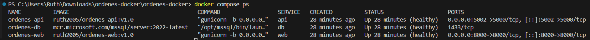

**Listado de órdenes en el navegador:**

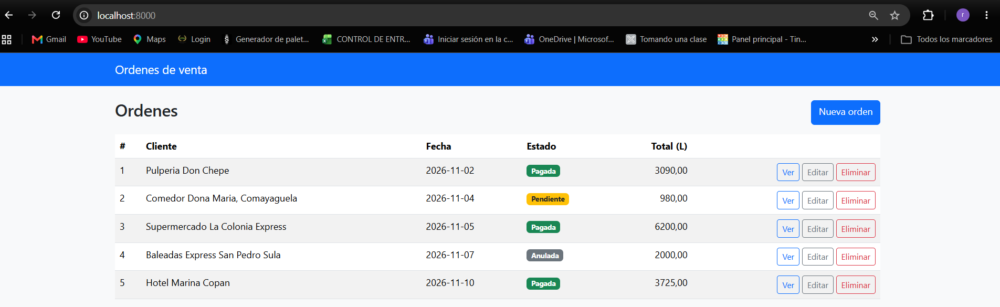

**Formulario de nueva orden:**

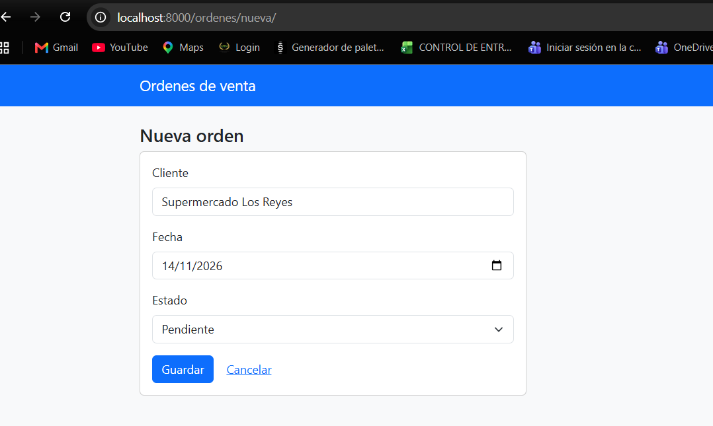

**Orden creada:**

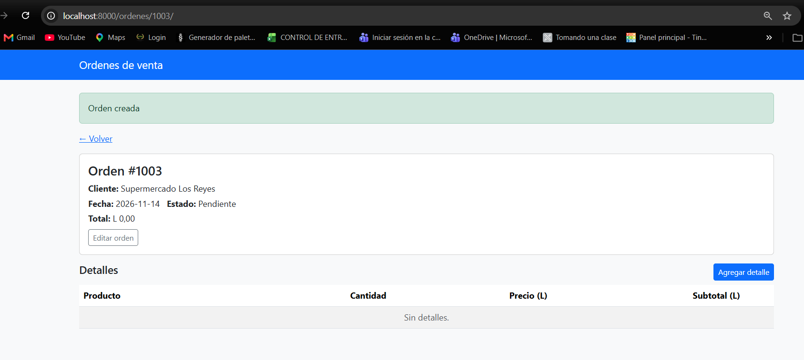

**Formulario para agregar un detalle:**

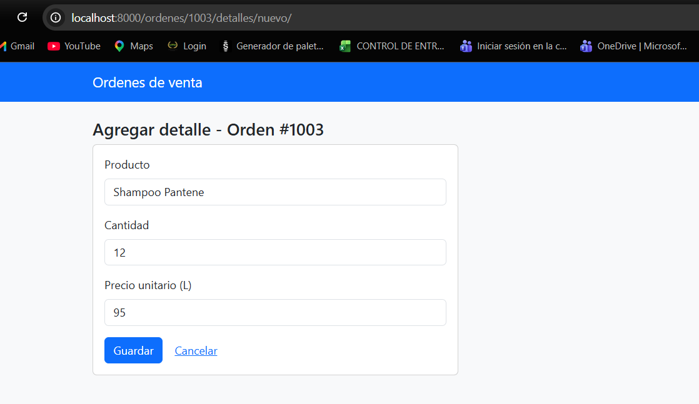

**Detalle agregado y total recalculado:**

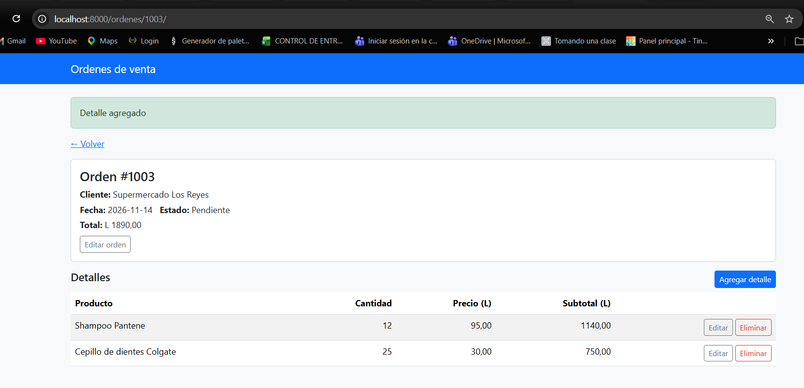

**Listado actualizado con la nueva orden:**

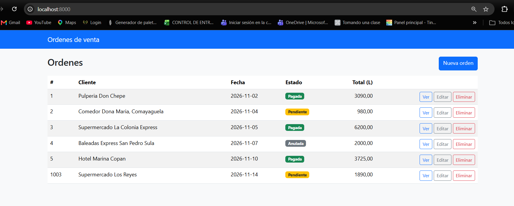

**Formulario de edición de una orden:**

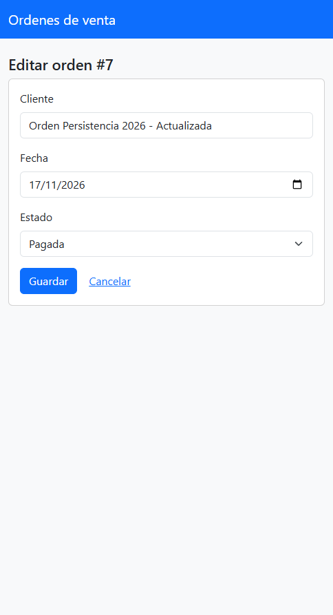

**Orden actualizada, con mensaje de confirmación:**

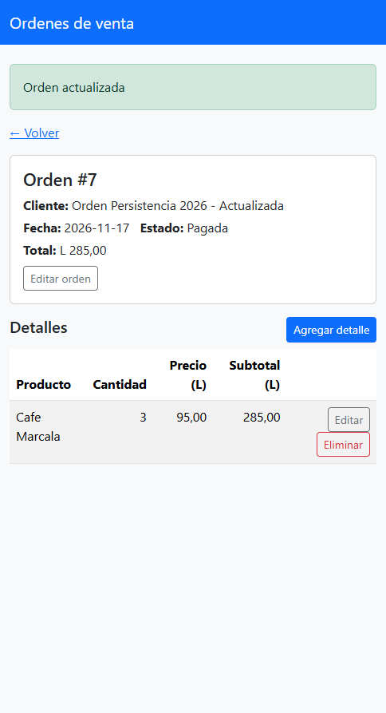

**Orden eliminada, con mensaje de confirmación:**

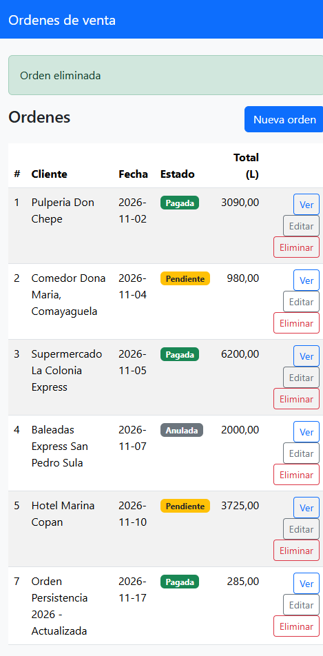

**Respuesta JSON de la API desde el navegador:**

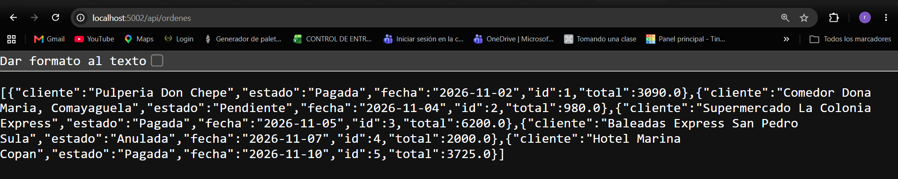

**Pruebas de la API con `curl`: códigos 200, 201, 400 y 404, y recálculo del total:**

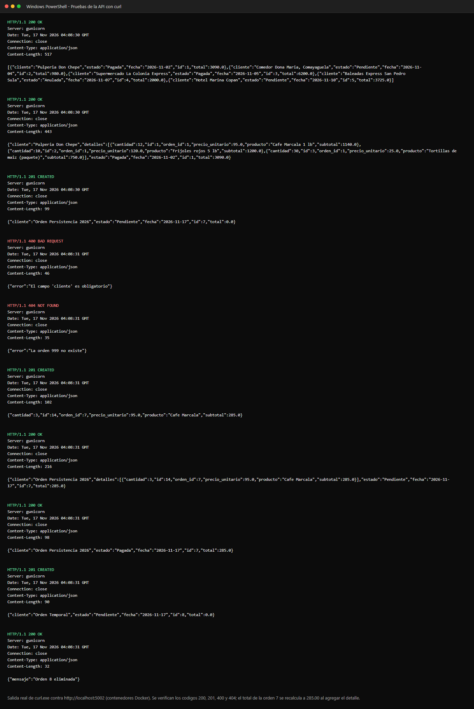

**Persistencia de los datos después de `docker compose down` y `docker compose up -d`:**

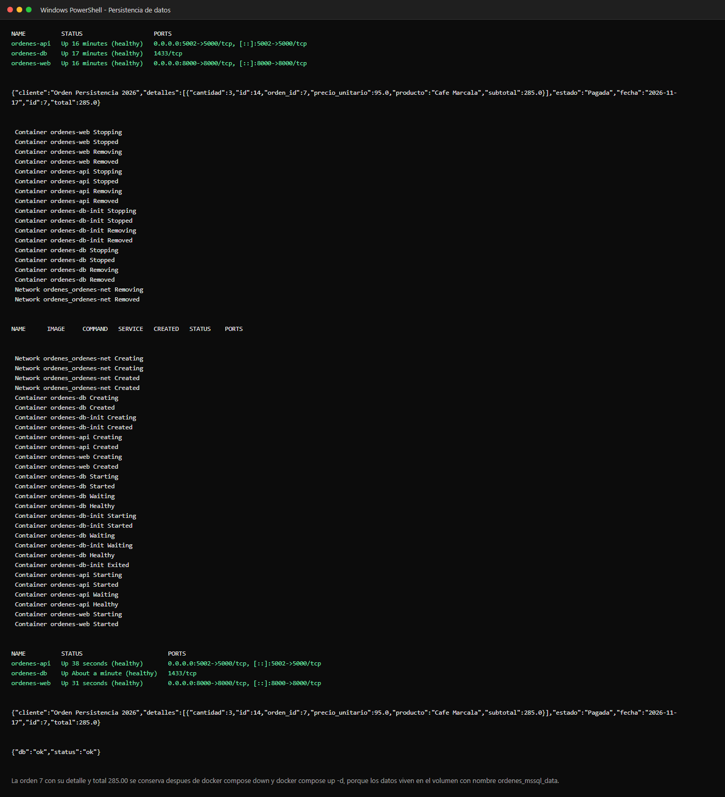

**Consumo y límites de CPU y memoria** (`docker stats`):

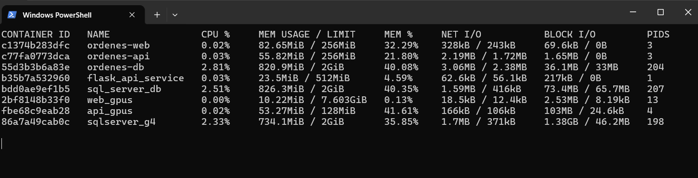

Las capturas de terminal muestran la salida real de los comandos ejecutados con Docker Desktop en Windows; las capturas de la interfaz se tomaron sobre la aplicación levantada con `docker compose up -d --build`.
